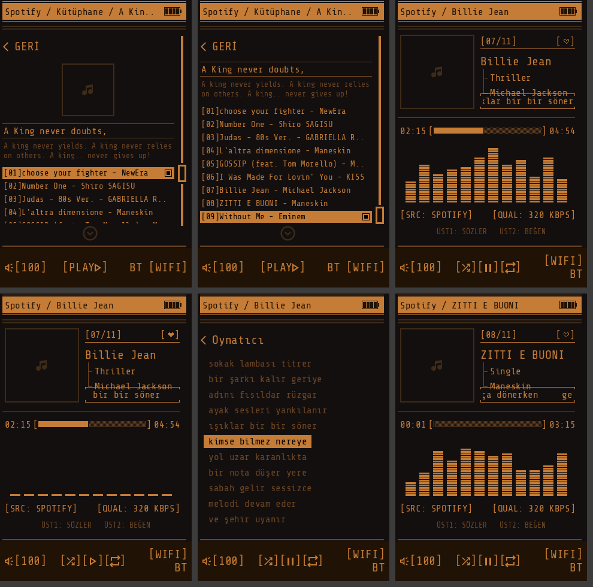
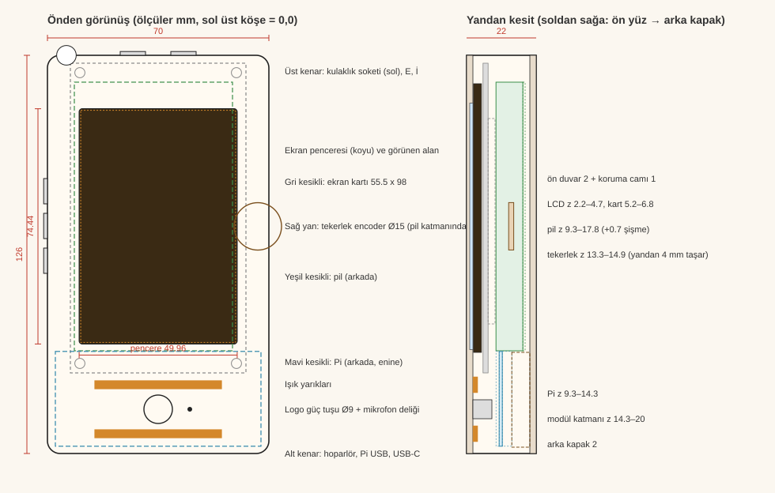
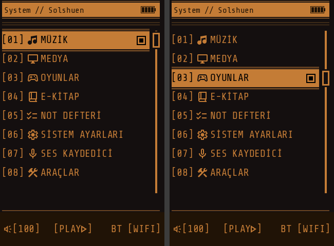
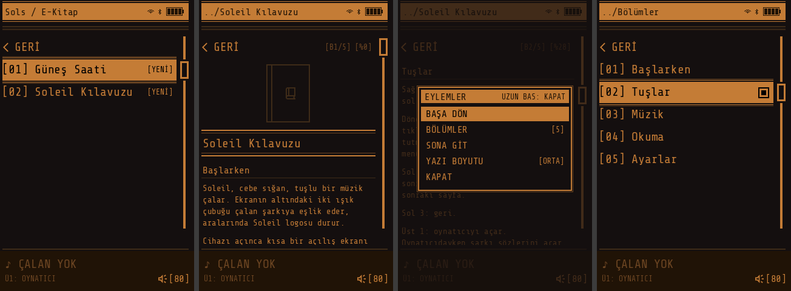
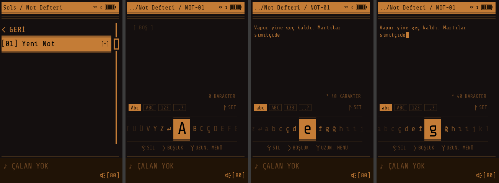
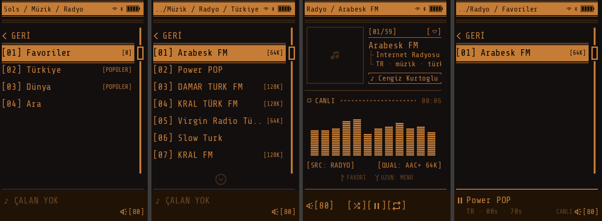
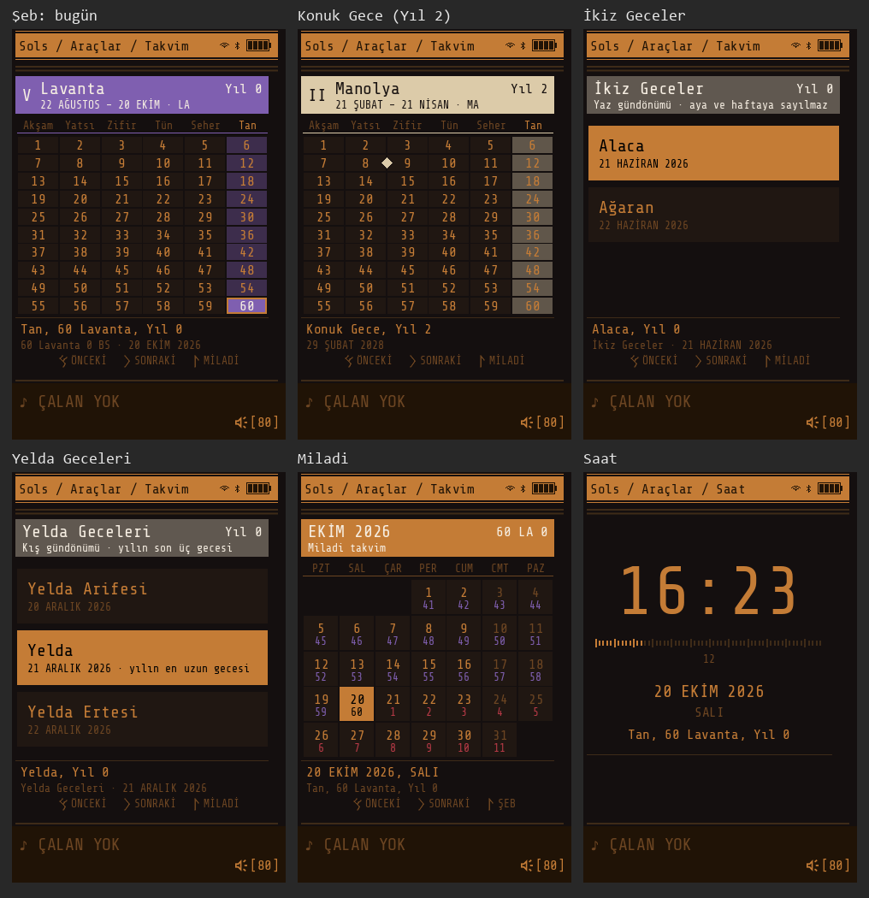
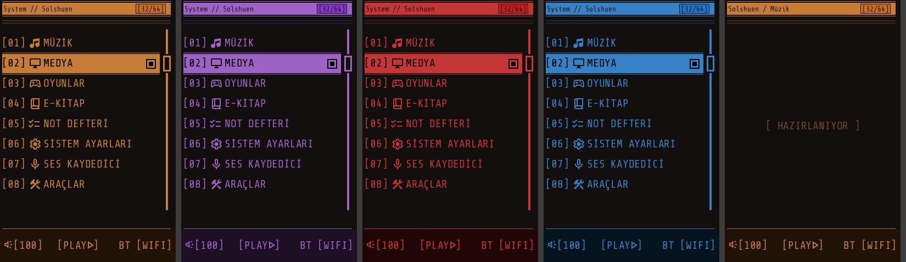

# Soleil

Soleil is a retro-futuristic music player I am building on a Raspberry Pi Zero 2 W. I design its case, its interface and SoleilOS, the software that runs on it. The software already runs on a computer. The device itself has not been assembled yet, and the first test on real hardware will happen once the parts arrive.



## The device

The body is about the size of an old iPhone (70 x 126 x 22 mm). A 3.5 inch screen sits at the top of the front, with two thin light bars and a logo below it. The speaker is on the bottom edge and the headphone jack is in the top left corner. The controls are a wheel (encoder) on the right side and five buttons: three on the left side and two on top.

The parts list, pin plan and case measurements are in the [donanim](donanim/README.md) folder.



## SoleilOS

SoleilOS is an interface written with Pygame. Its screens are drawn from measurements of the Figma designs. On a computer it runs with the keyboard, and on the device with the wheel and the buttons.

- **Music:** Local music library (mp3, flac, ogg, m4a, wav, opus), covers, lyrics (LRCLIB, optionally Spotify), internet radio, liked songs
- **Reader:** Notes and e-books, chapters, remembers where you left off
- **Notebook:** A dial that picks letters with the wheel
- **Tools:** Stopwatch, timer, calculator, screen light
- **Other:** Image viewer, voice recorder, calendar, Bluetooth, system info
- **Games:** Breakout and Snake
- **Themes:** Amber, purple, red and blue

The hints on the buttons and on the screen use Old Turkic letters. Together the six of them spell SOLEİL.

| | | |
|---|---|---|
|  |  |  |
|  |  |  |

## Running it on a computer

```
cd soleilos
pip install -r requirements.txt
python main.py
```

Sound needs mpv. Details and the full key list are in [soleilos/README.md](soleilos/README.md). Setting it up on a Pi is covered in [soleilos/pi/README.md](soleilos/pi/README.md). Both are in Turkish, and so is the interface.

## Folders

```
soleilos/      SoleilOS source code, tests and screenshots
donanim/       parts list, pin plan, case measurements and wiring diagram
```

## License

- SoleilOS: [MIT](LICENSE)
- Hardware documents: [CC BY-NC 4.0](donanim/LICENSE)
- Fonts: [SIL Open Font License](soleilos/assets/fonts/OFL.txt)
